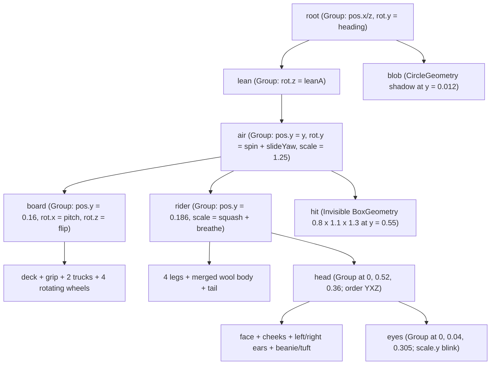

# 3D Architecture & Engineering Specification — Sheep Skate

> **Status:** Authoritative Technical Spec | **Baseline:** [`index.html`](../index.html) (`three@0.164.1`).

---

## 1. World Coordinate System & Spatial Layout

- **Axes:** Standard Three.js right-handed **Y-up** (`+X` right, `+Y` up, `+Z` toward viewer).
- **Scale:** `1` world unit `≈ 1` meter. A sheep's bounding volume is `0.72 × 1.02 × 1.22 m` (matching the `#tag` display `0.72 × 1.02 m`).
- **Heading Convention (`L807`, `L871`):** `heading = 0` faces **`+Z`**. Forward unit vector is `(Math.sin(heading), 0, Math.cos(heading))`.

### Landmark & Obstacle Coordinates (`index.html` `L212-L219`, `L379-L461`)

| Feature | Exact Bounds / Coordinates | Height (`o.h`) | Purpose |
| :--- | :--- | :---: | :--- |
| **Island Top** | `IW = 26`, `IH = 18` (`x: [-13, 13]`, `z: [-9, 9]`) | `y = 0` | Ground plane (`PlaneGeometry(26, 18)`) |
| **Player Boundary** | Hard clamp `|x| <= 12.1`, `|z| <= 8.1`; steer avoid `11.3 / 7.4` | — | Prevents rolling off meadow edge |
| **Concrete Plaza** | `x: [-4.5, 8.5]`, `z: [-4.2, 4.8]` (`13 × 9 m`) | `y = 0` | Primary flat skating surface |
| **Pond** | Center `(-8.7, 3.3)`, `rx = 2.5`, `rz = 1.75`; blockers `(-9.7, 3.3)` & `(-7.7, 3.3)` `r = 1.7` | `h = -1` | Cannot be jumped over (`o.h < 0`) |
| **Coral Rail** | `a = (-0.8, 0, -2.6)` to `b = (4.8, 0, -2.6)` (`L = 5.6 m`) | `top = 0.5`, `RAIL_Y = 0.33125` | Blockers `r = 0.3, h = 0.56, tag: 'rail'` (`SHEEP_SCALE = 1.25`) |
| **Left Quarter Pipe** | `(-2.9, 0, 0.3)`, `rotY = π`, `R = 1.1`, `deck = 0.55`, `Wd = 3.3` | `h = 1.2` | 3 blockers at `x = -3.7, z ∈ {-0.9, 0.3, 1.5}` |
| **Right Quarter Pipe** | `(6.9, 0, 0.3)`, `rotY = 0`, `R = 1.1`, `deck = 0.55`, `Wd = 3.3` | `h = 1.2` | 3 blockers at `x = 7.7, z ∈ {-0.9, 0.3, 1.5}` |
| **Funbox Ledge** | `(2.6, 0.19, 2.7)`, `2.6 × 0.38 × 0.85 m` | `h = 0.4` | 3 blockers at `x ∈ {1.6, 2.6, 3.6}, z = 2.7` |
| **Trees (×11) & Bushes (×6)** | Perimeter meadow (`[-11.4..11.4] × [-7.4..7.6]`) | `h = 3` / `0.6` | Trees `r = 0.8 * scale`, bushes `r = 0.55` |

---

## 2. Rendering, Lighting & Camera Pipeline (`index.html` `L173-L210`)

| Subsystem | Prototype Configuration | Notes |
| :--- | :--- | :--- |
| **Renderer** | `THREE.WebGLRenderer({ antialias: true, alpha: true })` | Transparent background lets radial CSS sky gradient show through |
| **Pixel Ratio & Tone** | `Math.min(devicePixelRatio, 2)`, `ACESFilmicToneMapping`, `exposure = 1.08` | Balanced highlight rolloff on white wool & bright concrete |
| **Shadows** | `VSMShadowMap` (`2048 × 2048`), `radius = 7`, `blurSamples = 14`, `bias = -0.0005` | Ortho camera: `left/right ±17`, `top/bottom ±14`, `near 1`, `far 60` |
| **Environment IBL** | `PMREMGenerator.fromScene(new RoomEnvironment(), 0.04)`, `intensity = 0.32` | Soft specular fill on pond clearcoat, rail metal, and wheel trucks |
| **Lights** | `HemisphereLight(0xfff3df, 0x6b8a48, 1.35)` + Sun `DirectionalLight(0xffebcc, 2.7)` at `(-9, 20, 9)` | Warm sunlight + grassy bounce fill |
| **Camera** | `PerspectiveCamera(26, aspect, 0.1, 300)`, `CAM_DIR = (0, 25, 21).normalize()` | Responsive `fitCamera()` sets `d = 42 * max(1, 1.55 / aspect)` |
| **OrbitControls** | `target: (0.4, 0, 0.6)`, `dampingFactor: 0.07`, `enablePan: false`, `polar: [0.3, 1.15]`, `dist: [12, 70]` | Planned Phase 2 adds smooth Chase/Follow camera blend in `ride` mode |

---

## 3. Scene Graph & Hierarchical Sheep Rig (`index.html` `L608-L655`)

The sheep transform hierarchy isolates world translation/yaw, carving roll, jump elevation/spin, deck flips, and squash-and-stretch so hooves remain planted on the grip tape during crouch/land compressions (`air` scales the whole rig by `SHEEP_SCALE = 1.25`):



- **Pivot invariant:** `deck` top sits near `0.16 + 0.025 + grip ≈ 0.186`, matching `rider.position.y = 0.186`. Scaling `rider.scale.y` scales upward from the grip tape while `(1 - sq * 0.5)` preserves approximate volume on X/Z.
- **Screen-Space Overlay Projection (`L1040-L1062`):** Projects 8 local bounding corners `x ∈ ±0.36, y ∈ [0, 1.02], z ∈ [-0.6, 0.62]` through `s.air.matrixWorld` and `camera` to position `#sel`, `#tag`, and `#bar` (damped with `damp(..., 9, dt)` unless hovered).

---

## 4. Target Modular Architecture (`src/`)

To enable fast headless tests, deterministic physics, and clean AI collaboration, Phase 1 extracts [`index.html`](../index.html) into strict unidirectional layers:

```text
src/
├── shared/
│   ├── math.ts          # clamp, wrapA, damp, dampA, easing curves, Mulberry32 rng
│   ├── constants.ts     # G = 18, IW, IH, PLAZA, POND, RAIL, trick launch table
│   └── types.ts         # SimSnapshot, SheepState, InputFrame, SimEvent, ParkSchema (Zod)
├── sim/                 # PURE TYPESCRIPT — zero THREE / DOM / Audio imports!
│   ├── world.ts         # Obstacles, spatial hash grid, surface heightfield & ramp curves
│   ├── sheepSim.ts      # Pure sheep kinematics, grind state machine, trick & combo math
│   ├── flockSim.ts      # Separation, cones spring physics, fixed-step accumulator
│   └── parkSerializer.ts# Zod validation & JSON import/export
├── editor/
│   ├── commandStack.ts  # Bounded undo/redo stack (<= 100), add/del/dup/move/state cmds
│   └── selection.ts     # Selected sheep ID, hover ID, placement tool state
├── audio/
│   └── sfxEngine.ts     # Web Audio synthesizer with ref-counted continuous voices
├── render/
│   ├── sceneManager.ts  # Renderer, ACESFilmic, VSM shadows, PMREM, resize, camera modes
│   ├── islandBuilder.ts # paintIsland() CanvasTexture, soil slab, pond, props, instancing
│   ├── sheepView.ts     # Shared GEO/MAT registries, pooled hat/blob mats, interpolation
│   ├── particles.ts     # Puff/spark instanced or pooled updates (zero allocations)
│   └── overlayProjector.ts # 8-corner screen projection & raycasting
├── ui/
│   ├── hud.ts           # Safe DOM updates (textContent only), score bump, mute toggle
│   ├── floatingBar.ts   # Damped toolbar, sliding pill, keyboard hint swaps
│   └── bubbles.ts       # Pooled floating score pops & speech bubbles
└── main.ts              # Composition root: fixed-step loop + render interpolation + input
```


---

## 5. Physics, Collision & Skate Mechanics Engineering

### Fixed-Timestep Accumulator (Phase 2)
The prototype (`L1126`) uses variable `dt = Math.min(clock.getDelta(), 1/30)`, which causes jump apex drift between `60Hz` and `144Hz` monitors. Target loop runs pure simulation at `FIXED_DT = 1 / 60`:
- Clamp frame delta to `<= 0.1 s` to avoid spiral of death on tab switch.
- Store `prevPos / prevY / prevHeading` and `currPos / currY / currHeading` in `sim`, interpolating render transforms by `alpha = accumulator / FIXED_DT`.

### Surface & Ramp Heightfield Model (Phase 2 Upgrade)
Currently obstacles are flat 2D circles `{ x, z, r, h }` where `this.y > o.h` skips collision (`L813`). Upgrading to typed surface primitives enables true skatepark riding:
- **Quarter Pipe Surface:** Parametric arc `y(u) = R - sqrt(R² - u²)` for `u ∈ [0, R]` plus flat deck `y = R` for `u ∈ [R, R + deck]`. Rolling upward converts `speed` smoothly along tangent angle `θ`; crossing `u = R` with upward velocity detaches into `ramp_air` along surface normal/tangent.
- **Funbox Ledge Deck:** Oriented bounding box (`OBB`) checking top support `y >= box.top - eps` when descending (`vy <= 0`), plus two edge rail segments (`z = 2.7 ± 0.425`) usable by `catchRail()`.
- **Spatial Hash Grid:** Uniform `2 m × 2 m` grid for `O(1)` sheep separation (`L1132`), obstacle checks, and cone hits—removing `O(N²)` flock scaling.

---

## 6. Procedural Geometry & Performance Audit

### Current Prototype Geometry Inventory (`index.html`)

| Asset | Construction (`index.html`) | Approx. Tris / Cost | Audit Verdict |
| :--- | :--- | :--- | :--- |
| **Wool Body (`GEO.wool`)** | `woolGeo(7, 64, ...)`: 1 core `(24×16)` + ~51 Fibonacci spheres `(12×8)` merged | `~9,300` tris/sheep (`~84k` for 9 sheep) | **High:** Reduce sphere segments to `(8×6)` or 42 tufts (`~3.5k` tris) for identical silhouette |
| **Trees (×11)** | 7 `IcosahedronGeometry(..., 3)` blobs each (`1,280` tris × 7 + trunk) | `~99,000` static tris | **Heavy:** Detail `2` (`320` tris) + merged/instanced canopies cuts by `75%` (`~25k` tris) |
| **Grass Tufts (×900)** | Single `InstancedMesh` of `ConeGeometry(0.045, 0.2, 5)` | `9,000` tris, `1` draw call | **Optimal** |
| **Island Texture** | `2048 × 1418` Canvas2D Voronoi + 16k grass strokes + 9k speckles | `~11.6 MB` RGBA GPU + `~150–300 ms` startup | Acceptable; offscreen/WebWorker or `1024` fallback on low-DPR mobile |
| **Particles (`puffs` / `sparks`)** | `70` + `90` individual `THREE.Mesh` objects | Up to `160` draw calls when active | Convert to 2 `InstancedMesh` pools (`2` draw calls total) |
| **Per-Sheep Leaks** | `blob` `MeshBasicMaterial` (`L653`) & `hat` `MeshStandardMaterial` (`L645`) | Unreleased GPU programs/materials on delete | Share pooled materials by `BOARD_COLORS` index + dispose on eviction |

### Performance Budgets

| Metric | Desktop Target (`60–120 fps`) | Mobile Target (`60 fps`) |
| :--- | :---: | :---: |
| **Frame Time (CPU Sim + Render)** | `< 8 ms` | `< 14 ms` |
| **Draw Calls** | `< 120` | `< 60` |
| **Active Scene Triangles** | `< 150,000` | `< 75,000` |
| **Max Sheep in Sandbox** | `24` | `12` |
| **Per-Frame Heap Allocations (Hot Loop)** | **`0` objects** | **`0` objects** |
| **Island Texture Resolution** | `2048 × 1418` | `1024 × 709` |
