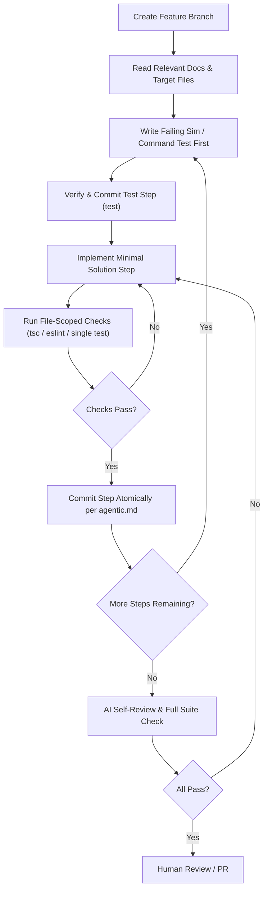

# Agentic Workflows & Quality Playbook — Sheep Skate

> Grounded in `/agentic-best-practices` and `/best-practices` for reliable AI-assisted development on **Sheep Skate**.
>
> **Mandatory Commit Policy:** All agents must follow [`agentic.md`](../agentic.md) — **COMMIT EACH VERIFIED STEP ATOMICALLY** using `<type>(<scope>): <summary>`. Never bundle multiple steps into a bulky commit.

---

## 1. Trust Spectrum by Subsystem

Apply review depth proportional to blast radius and subtlety:

| Trust Level | Sheep Skate Subsystems | Required Verification |
| :--- | :--- | :--- |
| **Low Trust** *(Strict Review)* | Zod park JSON import/export, DOM text rendering (`#tag`, `.pop`, `.bubble`), `src/sim/` physics & ramp math, fixed-step accumulator | Explicit unit tests + edge-case fuzzing (`NaN`, negative bounds, `<script>` strings) + manual code inspection |
| **Medium Trust** *(Targeted Tests)* | `CommandStack` undo/redo invariants, `SfxEngine` continuous voice ref-counting, `Sheep` state transitions, scoring & combo timer | Vitest state-transition tests + live audio/browser sanity check |
| **High Trust** *(Quick Review)* | Procedural prop placements, CSS token tweaks, UI copy, new deck color entries, documentation updates | Visual check + file-scoped lint/typecheck |

---

## 2. Standard Development Workflows

### Feature Development Workflow



### Bug Fix Workflow
1. **Reproduce:** Write a deterministic test (e.g., delete grinding sheep -> undo -> step `grindStep()`) that throws or fails before touching production code; optionally commit the isolated failing regression test (`test(scope): ...`) or keep paired strictly with its one-line fix.
2. **Isolate:** Pinpoint the exact invariant violation in `src/sim/`, `src/editor/`, or `src/render/`.
3. **Fix:** Apply the smallest surgical change solving the root cause.
4. **Verify & Commit Step:** Confirm the reproduction and edge-case tests pass, then immediately commit **only** that bug fix (`fix(<scope>): <summary>`) per [`agentic.md`](../agentic.md) before moving to any other bug.

### Safe Refactoring Workflow (Extraction from `index.html`)
1. Record visual/behavioral baseline first (trick heights, `"BAA"` plaza, `9` initial sheep, lighting).
2. Extract **one** pure module per commit (`math` -> commit -> `sim` -> commit -> `audio` -> commit -> `render` -> commit -> `ui` -> commit).
3. Never mix structural extraction with physics constant tweaks or visual redesigns in the same commit.

---

## 3. Copy-Paste Prompt Templates

### A. Implementing a New Skate Trick or Obstacle
```text
Context: Implementing [trick/obstacle] in src/sim/ and src/render/.
Read first: AGENTS.md, docs/GAME_DESIGN.md, docs/3D_ARCHITECTURE.md.

Requirements:
- [Exact trigger, vy/duration/points, or geometric bounds & height]
- Zero THREE/DOM imports inside src/sim/
- Zero per-frame allocations inside update loops
- Share pooled geometries/materials and dispose on entity deletion

Validation (implement ALL in tests/sim/):
- Happy path execution and points awarded
- Guarded edge case: triggering while inAir, onRail, or dying
- Combo multiplier increment and 2.4s expiry
- Undo/redo safety if state mutates

Done when:
- File-scoped tsc, eslint, and vitest pass
- Visual & audio feedback verified in browser
```

### B. Debugging a 3D, Physics, or Audio Issue
```text
Observation: [What is visibly/audibly happening]
Expectation: [Exact physical or audio behavior expected]
Relevant files: [file paths and line numbers]
Investigation: [Steps/logs observed so far]

Identify the root cause without guessing, check AGENTS.md invariants
(coordinate frame, fixed-step, audio ref-counting, GPU disposal),
propose a failing test first, then apply the minimal fix.
```

### C. Three-Phase Complex Feature Prompt
```text
Implement [feature] in 3 phases. STOP after each phase for verification:
- Phase 1: Pure simulation types, math, and Vitest unit tests (src/sim/)
- Phase 2: Three.js mesh/material view & particle/audio hooks (src/render/, src/audio/)
- Phase 3: Safe DOM HUD/toolbar controls & keyboard bindings (src/ui/)
Start with Phase 1 only.
```

### D. New Agent / Contributor Onboarding Prompt
```text
Read README.md, AGENTS.md, docs/GAME_DESIGN.md, and docs/IMPLEMENTATION_PLAN.md.
Summarize: (1) current prototype vs target modular layout, (2) the 3 most critical
rules in AGENTS.md, (3) which bug in docs/IMPLEMENTATION_PLAN.md is highest priority,
and (4) the exact file-scoped verification commands to run after edits.
```

---

## 4. Testing Strategy (Test Pyramid)

```text
        /\
       /  \       10% E2E / Visual Smoke (Playwright: WebGL boot, 0 console errors, click/trick)
      /----\
     /      \     30% Integration (CommandStack undo/redo, Zod JSON round-trip, Sfx state)
    /--------\
   /          \   60% Unit Tests (src/sim/*: trick arcs, combo decay, grind phases, obstacles)
  /____________\
```

- **Unit Tests (`tests/sim/`, target `< 10 ms` each):** Run completely headless in Node via Vitest. Seed all RNG (`rng(seed)`), assert deterministic positions/heights (`Math.abs(y - expected) < 1e-4`), and never mock away physics math.
- **Integration Tests (`tests/editor/`, `tests/audio/`):** Exercise command stacks (including deleting mid-grind and bounding at 100 entries) and Zod validation on valid + corrupted park JSON fixtures.
- **E2E Smoke (`tests/e2e/`):** Launch Vite preview in headless Chromium with SwiftShader/WebGL enabled, assert zero `pageerror`/console errors, click canvas, press `N` and `Space`, and check `#score` updates.

---

## 5. AI Self-Review & Pre-PR Checklist

Run this audit on generated diffs before concluding any task:

- **Functionality & Physics:** State transitions match [Game Design](GAME_DESIGN.md)? `doTrick()` guards `!inAir && !pending && !onRail && !dying`? Heading `0` still maps to `+Z`?
- **3D / GPU Hygiene:** Zero `new THREE.Vector3()` or `.clone()` inside per-frame paths? Dynamic materials/geometries disposed on permanent deletion? Draw calls & tris within budget?
- **Web Audio Hygiene:** Continuous loops ref-counted across multiple sheep? Gain ramps preceded by `setValueAtTime`? Context safely unlocked after user gesture?
- **Security & Robustness:** Zero dynamic strings passed to `.innerHTML`? Imported park JSON validated via Zod with finite ranges and bounded counts?
- **`AGENTS.md` Compliance:** `src/sim/` free of `THREE` and `DOM` imports? File sizes `< 300` lines? Undo stack bounded?

---

## 6. Continuous Improvement Loop

Follow `Observe -> Analyze -> Update -> Validate` monthly (or after every milestone phase):
1. **Observe:** Track recurring AI mistakes (e.g., forgetting `.dispose()`, introducing per-frame allocations, or leaking `THREE` types into `src/sim/`).
2. **Analyze:** Check whether a rule in [`AGENTS.md`](../AGENTS.md) was missing, vague, or buried too deep.
3. **Update:** Add a concrete **DO / DON'T** snippet referencing an actual file in `src/` and record major architectural shifts as a new ADR in [`docs/adr/`](adr/README.md).
4. **Validate:** Keep [`AGENTS.md`](../AGENTS.md) concise (`1,500–2,500` tokens) by pushing lengthy specs out to `docs/`.
