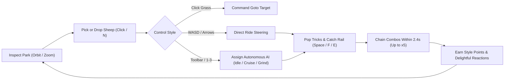
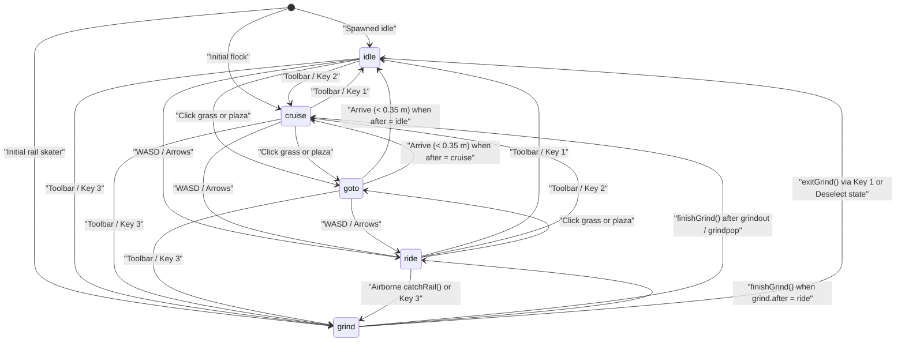

# Game Design Document — Sheep Skate

> **Status:** Living Design Spec grounded in [`index.html`](../index.html) | **Audience:** Gameplay engineers, designers, AI agents.

---

## 1. Vision & Design Pillars

**Sheep Skate** is a pastoral 3D skatepark diorama and playable sandbox editor. Instead of gritty concrete bowls and timers-first pressure, players tend a sunlit floating meadow where wooly skaters cruise, baa, carve around lily-pad ponds, bonk orange cones, and throw clean kickflips and boardslides.

### Four Design Pillars
1. **Tactile Toybox:** Every entity reacts physically to touch—hovering makes a sheep squash, clicking pops a speech bubble and *baa*, knocking cones tips them on damped springs, and grass tufts sway softly around concrete edges.
2. **Pastoral Cozy × Street Skate:** Warm storybook colors (cream parchment, sage hills, coral rails, pastel decks) juxtaposed with authentic skate language (ollie wind-ups, rail clanks, metal hiss, combo multipliers).
3. **Seamless Playable Editor:** Zero mode-switching friction. Selecting a sheep instantly brings up a Figma-inspired spatial bounding box, dimension tag, floating state pill, and undo/redo history—while `WASD` seamlessly promotes the selected sheep into direct control.
4. **Zero-Friction Juice:** Every interaction rewards the eye and ear: `0.09 s` squash anticipation before launches, dust puffs on landing, spark showers on rail slides, floating outlined score pops, and ascending combo chimes.

---

## 2. Core Gameplay Loops

- **Micro Loop (5–15 seconds):** Select a sheep -> steer into position or let AI approach -> pop an Ollie, Kickflip, or 360 (or catch the coral rail) -> land with dust puff + style pop -> chain another trick or cone bonk before the `2.4 s` combo timer decays.
- **Macro Loop (Session / Sandbox):** Curate an expressive multi-sheep skate session across the plaza and pasture, orchestrating simultaneous cruisers, rail grinders, and your hero skater; *(planned)* rearrange ramps/rails/props, customize sheep hats & decks, and chase 2-minute **Style Jam** park challenges.

---

## 3. Sheep Entity & State Machine

Every sheep (`Sheep` in [`index.html`](../index.html#L608-L893)) owns a finite behavioral state (`this.state`) plus orthogonal vertical/trick flags (`inAir`, `pending`, `onRail`).

### Grind Sub-Phases (`this.grind.phase`)
1. **`approach`**: Navigate toward run-up point `P` (`2.8 m` before start endpoint `S` along rail direction) at `max = 2.8 m/s` using obstacle avoidance. Switches to `runup` within `0.55 m`.
2. **`runup`**: Align heading to rail angle `g.ang`, accelerate toward `3.3 m/s`, gently pull lateral error `lat` onto the rail line. When `g.s > -1.05`, queue `pending = { type: 'grindpop', t: 0 }` (`0.09 s` crouch) and enter `up`.
3. **`up`**: Airborne approach arc (`vy = 5.3`). When descending (`vy < 0`) across `RAIL_Y = 0.33125` (`RAIL.top - 0.135 * SHEEP_SCALE`) with `s` in `(-0.45, L - 0.4)`, `landRail()` snaps onto the rail.
4. **`slide`**: Locked to `RAIL_Y`, `slideYawT = π/2` (boardslide perpendicular stance), emitting metal sparks (`dt * 70` per stream × 2) and continuous hiss sound until `s >= L - 0.05`.
5. **`out`**: Automatic pop off the end (`vy = 4.2`, `airDur = 0.5`, `trick = 'grindout'`), awarding **Boardslide +300** on ground landing before returning to `grind.after` (`cruise` or `ride`).

### Planned State Extensions (Phase 2)
- **`ramp_air` (Quarter-Pipe Transition):** Entered seamlessly when rolling up a quarter-pipe curve above threshold speed; converts horizontal momentum into vertical launch at the coping lip (`R = 1.1 m`) and aligns landing pitch to the curved surface.
- **`manual` (Combo Bridge):** Nose/wheelie balance triggered between flatground tricks to extend the `2.4 s` combo timer while rolling, draining stability proportional to turn rate.

### State Invariants (Bug Guardrails)
- Switching away from `'grind'` or removing a sheep **must** clear `onRail`, stop the sheep's rail hiss channel, and never leave `state === 'grind'` when `grind === null` (see known undo bug in [Implementation Plan](IMPLEMENTATION_PLAN.md)).
- `doTrick()` is gated on `!inAir && !pending && !onRail && !dying`.

---

## 4. Trick, Combo & Style System

### Implemented Trick & Scoring Catalog (`index.html` `L677-L694`, `L840-L844`, `L947-L956`)

With gravity `G = 18 m/s²`, total flight time for a flatground launch is `airDur = 2 * vy / G`:

| Action | Trigger | Launch `vy` | Airtime (`s`) | Peak Height (`m`) | Base Pts | Notes |
| :--- | :--- | :---: | :---: | :---: | :---: | :--- |
| **Ollie** | `Space` / Toolbar | `5.4` | `0.60` | `0.81` | `50` | Standard pop, nose pitch curve |
| **Kickflip** | `F` / Toolbar | `5.9` | `0.66` | `0.97` | `150` | Full `2π` roll (`flip`) via `easeIO` |
| **360 Spin** | `E` / Toolbar / Dbl-click | `6.4` | `0.71` | `1.14` | `200` | Full `2π` yaw (`spin`) via `easeIO` |
| **Grind Pop** | Auto in `grind` `runup` | `5.3` | `0.59` | `0.78` | `0` | Entry pop onto rail |
| **Boardslide** | Complete `slide` + land `grindout` | `4.2` *(exit)* | `0.50` *(exit)* | — | `300` | Big floating pop + rail spark/clank |
| **Cone Bonk** | Ground collision `speed > 0.7`, `d < 0.5` | — | — | — | `10` | Points awarded only in `ride` mode |
| **Drop Spawn** | `N` / Add button | `0` *(from `y = 6`)* | `~0.82` | `6.00` | `0` | Lands with dust puff and *baa* |

### Combo Multiplier Mechanics
- **Combo Window:** `comboT = 2.4 s` reset on every `award()` call.
- **Escalation:** Landing another scoring trick before `comboT <= 0` increments `combo` by `+1` up to **`×5`** (`total = pts * combo`).
- **Audio/Visual Feedback:** At `combo > 2` or `big === true` (Boardslide), `#score` triggers a spring bump (`scale(1.25) rotate(-4deg)`), pop text upgrades to `.big` gold (`#ffd35c`), and `Sfx.ding()` plays a two-tone chime (`880 Hz -> 1320 Hz`).

### Planned Trick & Scoring Expansion
- **Quarter-Pipe Lip Airs & Grabs:** Carving up a quarter pipe and popping at coping height (`1.1 m`) enables boosted `180/360/540` spins and Indy/Melon sheep grabs (`+250–450` base).
- **Ledge 50-50 & 5-0 Grinds:** Jumping onto the purple funbox (`L = 2.6 m`, `h = 0.38 m`) locks onto its top deck or coping edge.
- **Gap Bonuses:** Named spatial gaps (*Pond Skim*, *Funbox Clear*, *Rail-to-Ledge Transfer*) triggered when launching/landing across flagged volumes.
- **Freshness / Variety Decay:** Repeating the identical flatground trick consecutively within the same combo scales base points (`100% -> 75% -> 50%`) to encourage varied lines.

---

## 5. Park Environment & Interactive Toys

| Landmark / Prop | Coordinates & Dimensions | Current Behavior (`index.html`) | Planned Upgrade |
| :--- | :--- | :--- | :--- |
| **Island Meadow** | `26 × 18 m`, bounds `±12.1 × ±8.1` | Painted grass patches, flowers, dirt paths, soil cliff | Surface friction difference: grass (`0.88×` cruise drag) vs concrete (`1.0×`) |
| **Concrete Plaza** | `x: [-4.5, 8.5]`, `z: [-4.2, 4.8]` | Smooth skating apron with `"BAA"` art & curb markings | Surface-crisp rolling audio, optional chalk decals |
| **Duckless Pond** | `(-8.7, 3.3)`, `rx: 2.5`, `rz: 1.75` | Two `h: -1` blocking circles + 3 lily pads | Splash particle burst + comical bounce-out if landed inside |
| **Coral Flat Rail** | `(-0.8, -2.6)` to `(4.8, -2.6)`, `top: 0.5 m` | Full 5-phase autonomous grind & `ride`-mode `catchRail()` | Multi-rail support, sloped/kinked rails, wax speed boosts |
| **Quarter Pipes (×2)** | `(-2.9, 0.3, π)` teal & `(6.9, 0.3, 0)` peach | Visual extrude + metal coping (`R = 1.1 m`); `h: 1.2` blockers | Full parametric curved surface riding + lip launch physics |
| **Funbox Ledge** | `(2.6, 0.19, 2.7)`, `2.6 × 0.38 × 0.85 m` | Jumpable (`h: 0.4`) blocking circles; cannot land on top | Walkable/skateable flat top deck (`y = 0.38`) + grindable front/back edges |
| **Traffic Cones (×5)** | Scattered around plaza (`cd = 0.8 s`) | Spring-damped tilt (`tilt ∈ [-0.5, 1.35]`), bonk sound & `10` pts | Reset upright or scatter across park in editor mode |
| **Trees (×11) & Bushes (×6)** | Perimeter meadow & cherry blossoms | Swaying canopies (`sin(t * 0.9)`), hard obstacle trunks | Wind gust shake + falling blossom/leaf particles on collision |

---

## 6. Game Modes

1. **Pastoral Editor & Sandbox (Default Core):** Free-camera diorama where all sheep can be dropped, duplicated, directed, ridden, or parked. Will expand in Phase 3 to support placing/moving/rotating ramps, rails, ledges, and cones plus JSON export/import.
2. **Free Skate (Follow Camera):** Smooth chase/follow camera option behind the active sheep with instant `R` respawn-to-plaza and continuous combo tracking without toolbar clutter.
3. **Style Jam (2-Minute Arcade Run — Phase 4):** Timed `120 s` high-score session with 4 per-park pastoral goals (e.g., *Boardslide the Coral Rail*, *Bonk All 5 Cones*, *5,000 Style Points*, *Land a 360 over the Funbox*) recorded in local storage.

---

## 7. Flock Personality & Pastoral Cosmetics

- **Current Names (`NAMES` pool of 16):** `Woolbert`, `Baarbara`, `Lambo`, `Mutton Chop`, `Cotton`, `Clover`, `Nimbus`, `Biscuit`, `Tofu`, `Marsh`, `Dumpling`, `Fleecy`, `Pebble`, `Noodle`, `Juniper`, `Mochi` (overflow uses `Sheep N`).
- **Current Visual Variety:** `7` pastel skateboard decks (`BOARD_COLORS`), `35%` spawn probability for matching knit beanie + pom-pom (`hat`), otherwise fluffy head tuft, plus randomized `cruiseSpeed` (`2.0–2.7 m/s`) and roaming range (`wide` `30%`).
- **Planned Customization & Props (Phase 3):**
  - **Wool Palettes:** Cream, Charcoal Black-Sheep, Apricot Peach, Mint Sage.
  - **Hats & Gear:** Beanie, Straw Sunhat, Tiny Crown, Backward Cap, Round Sunglasses.
  - **Pastoral Obstacles:** Hay-bale hip, wooden barn kicker ramp, park picnic bench (grindable), flower planter gap.
  - **Flock Social Micro-Behaviors:** Nearby `idle` sheep turn heads toward a skater landing a `×3+` trick and cheer with a tiny `"baa!"` bubble.
