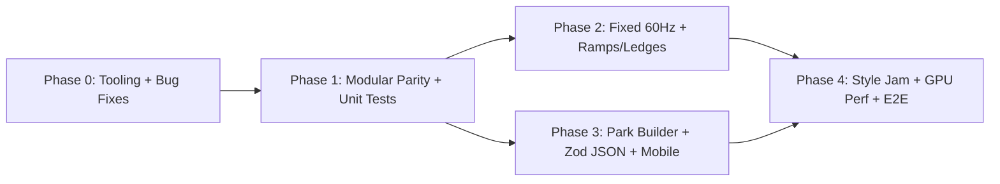

# Implementation Plan — Sheep Skate

> **Baseline:** [`index.html`](../index.html) (`1,164` lines, `79,137` bytes). Do **not** skip verification criteria between phases.

---

## 1. Prototype Audit & Known Issues Ledger

All issues below were directly observed in [`index.html`](../index.html) and must be resolved systematically *(note: ear rotation symmetry at `L861` has already been fixed in the current file)*:

| ID | Severity | Location | Root Cause | Fix Specification |
| :--- | :--- | :--- | :--- | :--- |
| **BUG-01** | **High** | `L909`, `L1017` | `removeSheep(s)` calls `s.exitGrind()`, which sets `s.grind = null` while leaving `s.state === 'grind'`. Undoing deletion calls `addSheep(s)` and crashes in `grindStep()` reading `g.S` on `null`. | Clear `s.state` or capture pre-delete state in the delete command; on `undo()`, re-run `s.setState('grind')` if `wasGrinding`. |
| **BUG-02** | **Medium** | `L522`, `L549-L550` | `Sfx` stores a single global `hiss` handle: if 2+ sheep grind simultaneously, the first exiting kills the other's rail hiss. Also `stopHiss` lacks `setValueAtTime` before ramping. | Ref-count active grinders (`Set<SheepId>`) and anchor `g.gain.setValueAtTime(g.gain.value, now)` before ramping to `0`. |
| **DEBT-01** | **High** | `L744-L745`, `L885-L886`, `L963` | Per-frame `new THREE.Vector3()` in `grindStep()`, `ride()`, and `.clone()` in `placeBubble()` cause continuous GC churn. | Hoist module-scoped `_v3A`, `_v3B`, `_fw`, `_rt` scratch vectors. |
| **DEBT-02** | **High** | `L645`, `L653`, `L1000` | Each sheep allocates an unshared `blob` `MeshBasicMaterial` and `hat` `MeshStandardMaterial` that are never `.dispose()`d; unbounded `history` retains deleted `THREE.Group` trees forever. | Share pooled `blobMat` (cloning only opacity via instance or shared shader/uniform) and pooled `hatMats[color]`; bound undo stack to `<= 100` and dispose evicted sheep resources. |
| **DEBT-03** | **High** | `L943`, `L1053` | `popText` and `tagEl` write interpolated strings via `.innerHTML`. Safe only while names are hardcoded; blocks user-named sheep or park JSON import. | Build child nodes once and assign dynamic strings strictly via `.textContent`. |
| **DEBT-04** | **Medium** | `L826`, `L1126` | Variable-timestep Euler integration (`dt <= 1/30`) introduces subtle airtime and apex variance across `60Hz`, `120Hz`, and `144Hz` screens. | Run pure simulation in a fixed `1/60 s` accumulator with render interpolation. |
| **PERF-01** | **Medium** | `L394`, `L569` | `11` trees use `IcosahedronGeometry(..., 3)` (`~99k` static tris); `woolGeo` creates `~9.3k` tris/sheep; particles use `160` separate meshes. | Reduce tree detail (`2`), reduce wool sphere segments (`8×6`), and batch particles into `InstancedMesh` pools. |

---

## 2. Phased Roadmap

### Phase 0 — Repo Hygiene, Build Tooling & Critical Bug Fixes
- **Goal:** Establish version control, TypeScript build/test tooling, local bundled dependencies, and fix all verified bugs (`BUG-01`, `BUG-02`, `DEBT-01..03`) while keeping the prototype intact.
- **Deliverables:**
  1. Initialize `git` repository + `.gitignore` (`node_modules`, `dist`, `.remember/tmp/`).
  2. Initialize `package.json`, `tsconfig.json` (`strict: true`, `exactOptionalPropertyTypes: true`), Vite, `three` (`@types/three`), `zod`, `vitest`, `eslint`, `prettier`.
  3. Apply fixes for `BUG-01` (undo-grind crash), `BUG-02` (ref-counted `Sfx.hiss`), `DEBT-01` (scratch vectors), `DEBT-02` (shared materials + bounded history), and `DEBT-03` (`.textContent` instead of `.innerHTML`).
- **Done When:**
  - `npx tsc --noEmit` and `npm run build` pass with `0` errors.
  - Deleting a grinding sheep and pressing `Ctrl+Z` restores it back into `'grind'` without console errors.
  - Heap snapshot / allocation profile shows `0` `Vector3` allocations in `ride()` and `placeBubble()` per frame.

### Phase 1 — Modular Parity Extraction & Headless Sim Tests
- **Goal:** Split [`index.html`](../index.html) into clean `src/` layers (`sim`, `editor`, `audio`, `render`, `ui`, `shared`) per [3D Architecture](3D_ARCHITECTURE.md) with 100% visual & gameplay parity.
- **Deliverables:**
  1. Extract pure math & constants (`src/shared/math.ts`, `src/shared/constants.ts`).
  2. Extract `src/sim/` (`sheepSim.ts`, `flockSim.ts`, `world.ts`) with **zero** `three` or `DOM` imports.
  3. Extract `src/editor/commandStack.ts`, `src/audio/sfxEngine.ts`, `src/render/*`, `src/ui/*`.
  4. Write unit tests (`tests/sim/`, `tests/editor/`) covering trick launch/airtime math, combo escalation/expiry, grind sub-phases, and undo/redo invariants.
- **Done When:**
  - `grep` / ESLint `no-restricted-imports` confirms `src/sim/` has zero `three` or DOM imports.
  - Full Vitest suite passes (`>= 20` deterministic unit tests, total runtime `< 1 s`).
  - Side-by-side manual check confirms lighting, `"BAA"` plaza, sheep behavior, audio, and toolbar match the baseline.

### Phase 2 — Fixed-Timestep Engine & True Skatepark Physics
- **Goal:** Upgrade from flat-circle obstacle blockers (`DEBT-04`) to deterministic `60Hz` simulation and rideable quarter pipes, funbox decks, manuals, and follow camera.
- **Deliverables:**
  1. Implement `FIXED_DT = 1/60` accumulator + previous/current transform interpolation (`alpha`) in `src/main.ts` and `src/render/sheepView.ts`.
  2. Build parametric Quarter Pipe curved surface & lip air launch (`ramp_air` state) for both existing ramps (`(-2.9, 0.3)` and `(6.9, 0.3)`).
  3. Make the purple Funbox (`(2.6, 0.19, 2.7)`) landable on top (`y = 0.38`) and grindable along its front/back edges.
  4. Support multi-rail registry + manual combo bridging + toggleable Follow Camera in `ride` mode.
- **Done When:**
  - Automated sim test verifies identical jump apex (`0.81 m` ollie, `0.97 m` kickflip) whether stepped at simulated `30fps`, `60fps`, or `144fps`.
  - Sheep rides up a quarter pipe, catches air above the `1.1 m` coping, lands back down smoothly, and grinds across the funbox edge.

### Phase 3 — Park Builder, Flock Customizer & Persistence
- **Goal:** Turn the editor from a sheep-only toolbar into a full pastoral skatepark creator with safe JSON persistence and mobile touch controls.
- **Deliverables:**
  1. Unified obstacle & prop placement tools (add/move/rotate/delete rails, ramps, funboxes, cones, hay bales) wired into the bounded `CommandStack`.
  2. Sheep customizer popover (name input safely rendered via `textContent`, wool tint, deck color, hat selector).
  3. Zod-validated Park JSON Export / Import + `localStorage` autosave (`src/sim/parkSerializer.ts`).
  4. Responsive touch joystick + trick buttons for viewports `< 720 px`.
- **Done When:**
  - Fuzz/unit tests prove malformed or malicious Park JSON (e.g., `<script>` names, `NaN` coords, 10,000 obstacles) is safely rejected by Zod.
  - Placing, rotating, deleting, and undoing a park prop leaves zero leaked Three.js meshes or orphaned collision shapes.

### Phase 4 — Style Jam Mode, GPU Optimization & E2E Verification
- **Goal:** Ship a complete arcade game loop alongside sandbox mode while meeting mobile/desktop performance budgets.
- **Deliverables:**
  1. **Style Jam** `2:00` timed run with park goal checklist, trick variety decay, gap triggers, and local best scores.
  2. Geometry & draw-call pass (`PERF-01`): optimize `woolGeo` & tree canopies, batch `puffs`/`sparks` into `InstancedMesh` pools, add `1024 px` island canvas fallback on low-power devices.
  3. Spatialized wheel rolling audio (`StereoPannerNode`) + ambient pastoral bed.
  4. Playwright headless WebGL smoke suite (`tests/e2e/`) verifying clean boot, zero console/page errors, sheep selection, trick pop, and undo/redo.
- **Done When:**
  - Scene maintains `< 120` draw calls and `< 150k` triangles on desktop (`< 60` draw calls / `< 75k` tris on mobile preset).
  - `npm test` and `npm run test:e2e` pass in CI cleanly.

---

## 3. Phase Dependency Flow

